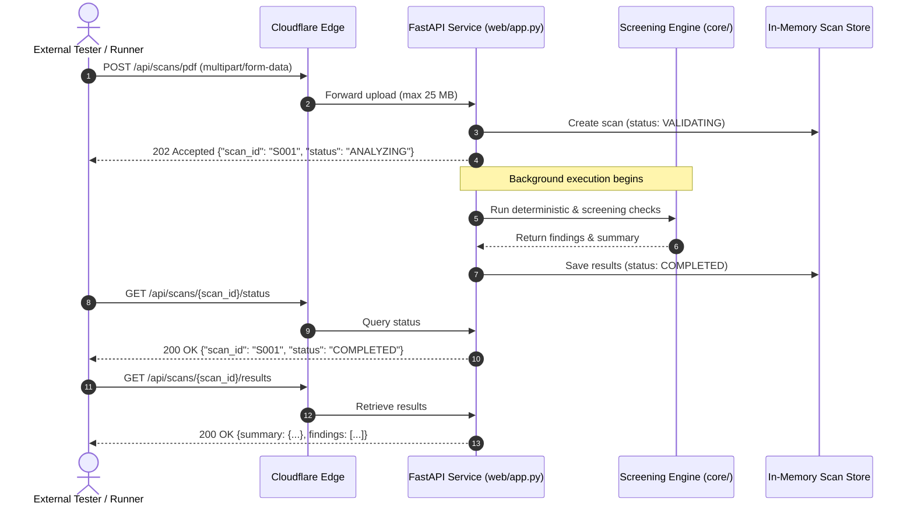
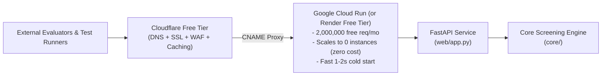
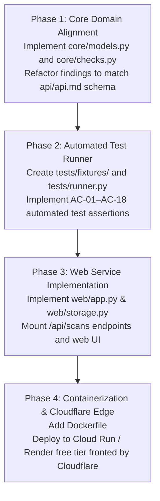

# Web Hosting & Architecture Plan — ADA Accessibility Checker

## 1. Executive Summary & Regulatory Alignment

This plan aligns the ADA PDF Accessibility Checker codebase with the project specification in `api/api.md`, the requirements in `requirements_validation/requirements.md` (REQ-01 through REQ-19), and acceptance criteria in `requirements_validation/acceptance_criteria.md` (AC-01 through AC-18).

The objective is to deploy a lightweight, scalable web service that supports:
1. **Asynchronous REST API:** Implements the official scan lifecycle (`POST /api/scans/pdf`, `POST /api/scans/web`, `GET /api/scans/{scan_id}/status`, `GET /api/scans/{scan_id}/results`).
2. **Standardized Finding Model:** Formats findings into `finding_id`, `input_location`, `issue_description`, `WCAG_criterion`, `analysis_method`, `status`, and `remediation_guidance`.
3. **Automated Test Runner System:** An automated test harness validating acceptance criteria against curated fixture PDFs and web endpoints.
4. **Cloudflare & Scale-to-Zero Deployment:** 100% free for <1,000 requests on container compute (Google Cloud Run / Render) fronted by Cloudflare's free edge network.

---

## 2. API Specification & Status Lifecycle (per `api/api.md`)



### 2.1 Formal Endpoints Matrix

| Method | Endpoint | Request | Success Response | Error Codes | Requirements |
|---|---|---|---|---|---|
| `POST` | `/api/scans/pdf` | `multipart/form-data` with `file` (≤25 MB) | `202 Accepted`<br/>`{"scan_id": str, "status": "ANALYZING"}` | `400` (corrupt), `413` (>25MB), `415` (non-PDF), `500` | REQ-02, REQ-03, REQ-12, REQ-15 |
| `POST` | `/api/scans/web` | JSON `{"url": "https://..."}` | `422 Unprocessable Entity`<br/>`{"error": "UNSUPPORTED_INPUT", "message": "Webpage scanning is outside current prototype scope; use /api/scans/pdf."}` *(or 202 transitioning to REJECTED)* | `400` (invalid URL), `422` (unsupported/scope), `500` | REQ-01, REQ-02, REQ-12 |
| `GET` | `/api/scans/{scan_id}/status` | Path parameter `scan_id` | `200 OK`<br/>`{"scan_id": str, "status": "<STATE>"}` | `404` (not found) | REQ-12, REQ-13, REQ-18 |
| `GET` | `/api/scans/{scan_id}/results` | Path parameter `scan_id` | `200 OK`<br/>`{summary: {...}, findings: [...]}` | `404` (not found), `409` (not ready) | REQ-06–REQ-10, REQ-15, REQ-17 |
| `POST` | `/api/test-runner` | Optional JSON options | `200 OK`<br/>`{total: int, passed: int, results: [...]}` | `500` | AC-01–AC-18 automated test suite |
| `GET` | `/` | Web browser | `200 OK` (HTML Portal) | — | Human evaluator testing portal |
| `GET` | `/docs` | Web browser | `200 OK` (OpenAPI Swagger UI) | — | Direct interactive test interface |

### 2.2 Domain Enums and Allowed Values
- **Scan Status:** `VALIDATING` | `ANALYZING` | `GENERATING_REPORT` | `COMPLETED` | `REJECTED`
- **Finding Status:** `Pass` | `Issue` | `Needs Human Review` | `Could Not Evaluate`
- **Analysis Method:** `Deterministic` | `AI` | `Human Review`

---

## 3. Web Hosting & Infrastructure (<1,000 Requests Free Tier)

### 3.1 Compute vs. Edge Boundary
- **Engine Dependency:** `pymupdf` bundles native C MuPDF binaries. Cloudflare Workers Python environment uses Pyodide without C-extension support.
- **Solution:** Host the FastAPI container on a container platform that scales to zero, using Cloudflare's free edge network as the frontend proxy.



### 3.2 Security & Data Protection (REQ-16, REQ-17)
- **In-Memory Buffer Processing:** PDF files are streamed into Python memory buffers (`io.BytesIO`) and evaluated directly; no uploaded files are written to publicly accessible directories.
- **Short-Lived Scan Store:** Scan results and in-memory references expire after 1 hour or upon request.
- **Secret Isolation:** No API keys or credentials committed or output in accessibility reports.

---

## 4. Modular File Architecture & Component Specifications

```text
ada-pdf-accessibility-checker/
├── core/
│   ├── __init__.py           # Package exports
│   ├── models.py             # Dataclasses adhering to api/api.md schema
│   ├── checks.py             # Pure deterministic WCAG check functions
│   └── checker.py            # PDF & Web scanning coordinator
├── tests/
│   ├── fixtures/             # Curated PDFs for deterministic validation
│   │   ├── fixture_accessible.pdf
│   │   ├── fixture_scanned.pdf
│   │   └── fixture_images.pdf
│   └── runner.py             # Automated test suite (AC-01 through AC-18)
├── web/
│   ├── __init__.py
│   ├── app.py                # FastAPI routes matching api/api.md
│   ├── storage.py            # In-memory scan state & results manager
│   └── templates/
│       └── index.html        # Clean web upload & automated test runner UI
├── Dockerfile                # Production container for Cloud Run / Render
├── pdf_checker.py            # Backward-compatible CLI wrapper
├── pyproject.toml            # Project dependencies
└── README.md
```

### 4.1 Component Details

#### 1. `core/models.py`
Defines data structures mapped directly to `api/api.md`:
```python
from dataclasses import dataclass, field
from typing import Literal, Optional

ScanStatus = Literal["VALIDATING", "ANALYZING", "GENERATING_REPORT", "COMPLETED", "REJECTED"]
FindingStatus = Literal["Pass", "Issue", "Needs Human Review", "Could Not Evaluate"]
AnalysisMethod = Literal["Deterministic", "AI", "Human Review"]

@dataclass
class Finding:
    finding_id: str
    input_location: str
    issue_description: str
    WCAG_criterion: str
    analysis_method: AnalysisMethod
    status: FindingStatus
    remediation_guidance: Optional[str] = None
    additional_details: Optional[str] = None

@dataclass
class ScanSummary:
    checks: int = 0
    passed: int = 0
    issues: int = 0
    human_review: int = 0
    could_not_evaluate: int = 0

@dataclass
class ScanResult:
    scan_id: str
    file_or_url: str
    summary: ScanSummary
    findings: list[Finding] = field(default_factory=list)
```

#### 2. `core/checks.py`
Implements deterministic checks with remediation guidance (REQ-05, REQ-08, REQ-09):
- `check_title()`: Cites WCAG 2.4.2 (Level A). Remediation: "Add a descriptive title in document properties."
- `check_language()`: Cites WCAG 3.1.1 (Level A). Remediation: "Set default document language in catalog."
- `check_structure()`: Cites WCAG 1.3.1 (Level A). Remediation: "Add document structure tags using authoring tool."
- `check_text_layer()`: Cites WCAG 1.4.5 (Level AA). Remediation: "Perform Optical Character Recognition (OCR)."
- `check_images()`: Cites WCAG 1.1.1 (Level A). Remediation: "Add alternative text for meaningful graphics."

#### 3. `web/storage.py`
In-memory thread-safe dictionary managing scan jobs:
- Tracks `scan_id -> {"status": ScanStatus, "results": Optional[ScanResult], "error": Optional[dict]}`.
- Auto-prunes scans older than 1 hour (REQ-16).

#### 4. `web/app.py`
FastAPI application mounting the specification endpoints:
- Validates 25 MB file limit, rejecting oversized files with HTTP 413.
- Validates MIME type, rejecting non-PDFs with HTTP 415.
- Dispatches background scan task, returning HTTP 202 immediately.
- Rejects `POST /api/scans/web` with HTTP 422 / `REJECTED` state explaining web scanning is outside current prototype scope (REQ-12).
- Provides interactive Swagger documentation at `/docs`.

#### 5. `tests/runner.py`
Automated test runner verifying acceptance criteria:
- Tests deterministic repetition (AC-04).
- Tests oversized/corrupt negative cases (AC-02, AC-11).
- Tests summary counts match findings exactly (AC-09).
- Tests disclaimer presence (AC-10, REQ-11).
- Returns structured JSON for HTTP `/api/test-runner` or terminal execution.

---

## 5. Phased Implementation Roadmap



### Next Immediate Action:
Proceed with **Phase 1** to modularize the models and check functions matching `api/api.md`.
