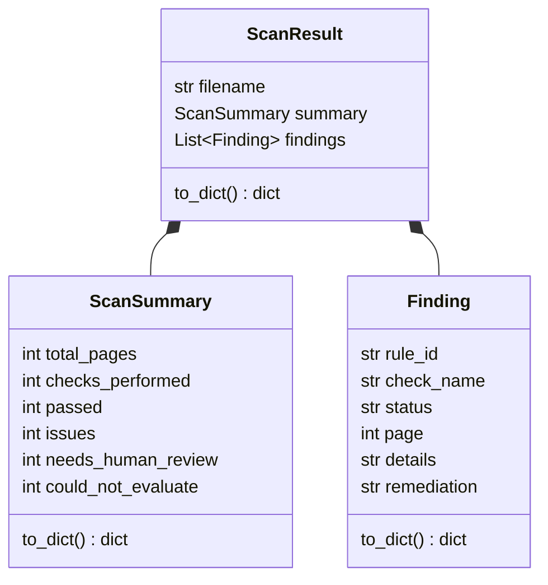
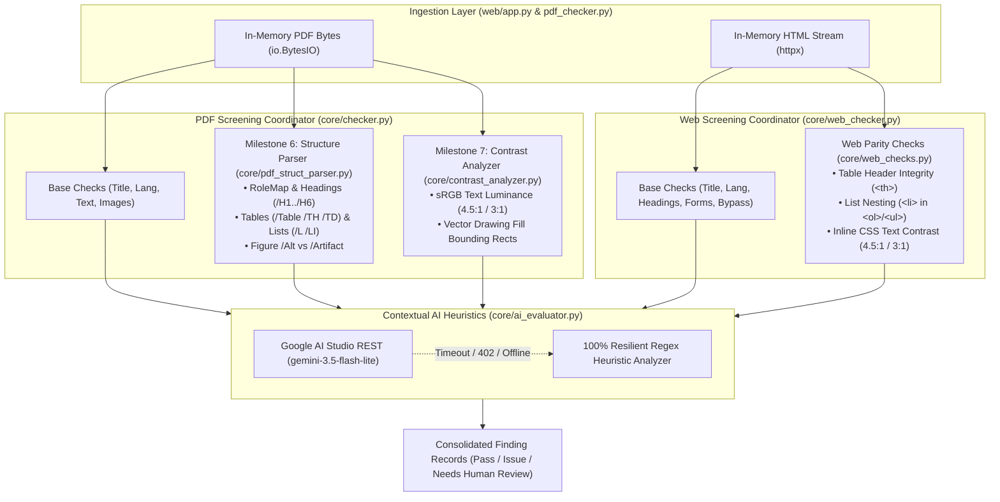
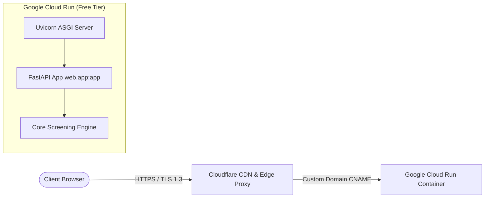
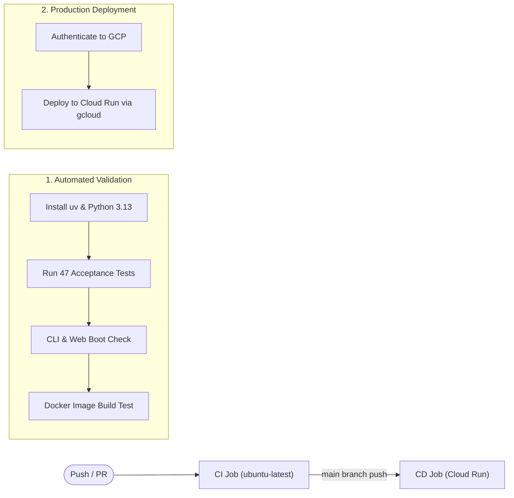

# System Architecture & Technical Specification

> **Executive Summary**: The ADA PDF Accessibility Checker is a decoupled, stream-oriented screening engine designed to evaluate digital PDF documents against key WCAG 2.1 Level AA and ADA Title II technical criteria. It provides both a CLI and an asynchronous FastAPI web service, operating under strict zero-disk-retention privacy guarantees and deploying to Google Cloud Run fronted by Cloudflare.

---

## 1. System Overview & Component Structure

The repository is organized into distinct, decoupled subsystems separating screening logic, delivery interfaces, automated testing, and infrastructure:

```text
ada-pdf-accessibility-checker/
├── core/                       # Core Screening Domain (Engine & Rules)
│   ├── models.py               # Strongly typed dataclasses & JSON serialization
│   ├── checks.py               # Pure, rule-based PDF screening evaluators
│   ├── checker.py              # PDF screening coordinator (PyMuPDF + pypdf)
│   ├── pdf_struct_parser.py    # Milestone 6: Deep PDF /StructTreeRoot parser & RoleMap
│   ├── contrast_analyzer.py    # Milestone 7: Visual & sRGB contrast calculation engine
│   ├── ai_evaluator.py         # Milestone 8: Contextual AI heuristic advisory engine
│   ├── web_checks.py           # Pure, rule-based HTML DOM screening evaluators & CSS contrast
│   ├── web_checker.py          # Webpage screening coordinator (HTMLParser)
│   └── web_fetcher.py          # In-memory async HTTP fetcher with SSRF protection
├── web/                        # Web Application & Delivery Layer
│   ├── app.py                  # FastAPI server & REST API routes (PDF & Web)
│   ├── storage.py              # In-memory scan job tracker with TTL expiration
│   ├── cross_team_routes.py    # Cross-team System & Tester API routes (Spec v2 compliant)
│   ├── cross_team_storage.py   # In-memory registry for System & Tester sessions
│   ├── templates/              # Jinja2 HTML templates
│   │   └── index.html          # Dual-screening Web UI portal (PDF & Web)
│   └── static/                 # Static delivery assets
│       ├── style.css           # UI styling & accessibility themes
│       └── app.js              # Client-side upload, URL scan, polling, & render logic
├── tests/                      # Automated Testing Subsystem
│   ├── runner.py               # Acceptance test runner (47 assertions covering AC & REQ)
│   ├── test_phase5_milestones.py# Milestone 6, 7, 8 and Parity unit & boundary tests
│   ├── test_roadmap_sections.py# Edge-case, security, and concurrency test suites
│   ├── test_cross_team.py      # Cross-team System and Tester ConOps test suite
│   ├── test_web_scanner.py     # In-memory HTML fixtures and SSRF acceptance tests
│   ├── http_cross_tester.py    # Outbound HTTP test engine for target screening APIs
│   └── fixtures/               # Curated PDF fixtures for deterministic testing
│       ├── fixture_accessible.pdf
│       ├── fixture_scanned.pdf
│       └── fixture_images.pdf
├── docs/                       # Project Documentation & Architecture
│   ├── ARCHITECTURE.md         # This document
│   ├── WCAG_CHECKS_REFERENCE.md# Check definitions, limits, and remediation catalog
│   ├── DECISION_LOG.md         # Architecture Decision Records (ADRs)
│   ├── ROADMAP.md              # Milestone tracking and future enhancements
│   ├── INTRA_POD_SPECIFICATION.md # Shared pod specification, models, interfaces & limits
│   ├── CROSS_TEAM_TESTING_PLAN.md # Cross-team test execution plan & coverage rationale
│   ├── CODE_COVERAGE_OPTIONS.md   # Evaluation of code coverage options for System role
│   └── CLOUD_HOSTING_COMPARISON.md # Multi-vendor cloud hosting evaluation
├── pdf_checker.py              # Command-line interface (CLI) entry point
├── Dockerfile                  # Container definition for Cloud Run deployment
├── pyproject.toml / uv.lock    # Project dependencies and lockfile (uv)
└── AGENTS.md                   # AI agent instructions and repository invariants
```

### Component Boundaries
- **`core/`**: Completely decoupled from HTTP frameworks and filesystem assumptions. All checks accept opened document handles (`pymupdf.Document` and `pypdf.PdfReader`) and return pure immutable dataclasses.
- **`web/`**: Manages HTTP request lifecycle, background async thread execution, in-memory job status tracking, and HTML/JSON responses.
- **`tests/`**: Independent test suite validating core checks against known fixtures without requiring a live web server.
- **`pdf_checker.py`**: Standalone CLI utility allowing direct terminal use and local batch screening.

---

## 2. Domain Models & Data Contracts

All screening findings and scan payloads adhere to strongly-typed dataclasses defined in [`core/models.py`](../core/models.py):



### Status Enums
Every screening evaluation yields exactly one of four normalized statuses:
- **`Pass`**: The structural heuristic was satisfied (e.g. document title metadata exists and is non-empty).
- **`Issue`**: A concrete accessibility barrier was detected (e.g. page lacks extractable digital text).
- **`Needs Human Review`**: Heuristic check succeeded partially or detected elements requiring human judgment (e.g. raster images discovered; alt-text appropriateness requires review).
- **`Could Not Evaluate`**: File corruption, encryption, or parser exception prevented evaluation.

---

## 2.1 Multi-Modal Screening Pipeline (Milestones 6, 7, and 8)

Phase 5 introduced a unified multi-modal screening pipeline coordinating deterministic structural inspection, visual contrast calculations, and contextual AI heuristics across both PDF documents and web HTML DOM streams:



1. **Milestone 6: Deep Semantic Structure Traversal (`core/pdf_struct_parser.py`)**:
   - Parses the document's `/StructTreeRoot` dictionary recursively.
   - Resolves custom structural tags using `/RoleMap`.
   - Validates sequential heading hierarchies (`/H1` to `/H6`), identifying skipped levels.
   - Asserts table row integrity (`/TR`) and header mapping (`/TH` to `/TD`).
   - Verifies list item encapsulation (`/L`, `/LI`, `/Lbl`, `/LBody`).
   - Inspects `/Figure` elements for `/Alt` descriptions or `/Artifact` decorative tagging.
2. **Milestone 7: Visual & Contrast Analysis (`core/contrast_analyzer.py`)**:
   - In-memory sRGB relative luminance ($L = 0.2126 R + 0.7152 G + 0.0722 B$) and contrast ratio formulas.
   - Evaluates text spans against background colors established by vector drawing fills (`page.get_drawings()`) or white default page background ($4.5:1$ normal text, $3:1$ large text).
   - Extends contrast evaluation to Web inline CSS declarations (`core/web_checks.py::check_web_contrast`).
3. **Milestone 8: Contextual AI Heuristic Assessment (`core/ai_evaluator.py`)**:
   - Evaluates qualitative criteria: Sensory Characteristics (`1.3.3`), Title Descriptiveness (`2.4.2`/`2.4.6`), and Color-Only Reliance (`1.4.1`).
   - Direct HTTP client calls to Google AI Studio (`gemini-3.5-flash-lite`) via `httpx` with zero heavy SDK dependencies.
   - 100% resilient offline fallback (`_local_heuristic_analyzer`) guarantees uninterrupted operation with advisory human review findings (`analysis_method="AI"`, `status="Needs Human Review"`).

---

## 3. REST API Specifications

The web interface ([`web/app.py`](../web/app.py)) exposes an asynchronous REST API:

| Method | Endpoint | Description | Request Payload | Response Status & Body |
|---|---|---|---|---|
| `POST` | `/api/scans/pdf` | Upload and initiate async screening | `multipart/form-data` (`file: UploadFile`) | `202 Accepted` → `{"scan_id": "...", "status": "running"}` |
| `GET` | `/api/scans/{scan_id}/status` | Poll job execution state | None | `200 OK` → `{"scan_id": "...", "status": "running\|completed\|error"}` |
| `GET` | `/api/scans/{scan_id}/results`| Fetch complete screening report | None | `200 OK` → `ScanResult` JSON payload |
| `GET` / `POST` | `/api/test-runner` | Run automated acceptance test suite | None | `200 OK` → `TestSuiteSummary` JSON payload |
| `POST` | `/system/test/setup` | Register and prepare test session for System under test | `{"session_id": "...", "setup": {}}` | `201 Created` → `{"session_id": "..."}` |
| `GET` | `/system/test/report`| Fetch code coverage for session under test | `?session_id=...` | `200 OK` → Coverage report |
| `POST` | `/tester/test/setup` | Initialize Tester session with target base URL | `{"target_url": "..."}` | `201 Created` → `{"session_id": "..."}` |
| `POST` | `/tester/test/run`   | Execute test suite against target system | `{"session_id": "..."}` | `200 OK` → Full suite report & coverage |
| `GET` | `/tester/test/report`| Fetch stored suite report after run | `?session_id=...` | `200 OK` → Stored suite report |
| `GET` | `/docs` | Interactive Swagger / OpenAPI documentation | None | `200 OK` (Interactive UI) |

---

## 4. Baseline Security & Privacy Invariants

The screening engine adheres to strict data minimization principles by design:

1. **Zero-Disk Retention (REQ-16, REQ-17)**:
   - User-uploaded PDF files are read directly from network streams into memory buffers (`io.BytesIO`).
   - Uploaded PDF bytes are never written to the filesystem, temporary directories (`/tmp`), or external persistent storage.
   - Once screening finishes, the memory stream is garbage collected.
2. **Ephemeral In-Memory Job Storage**:
   - Scan results and status metadata are stored in thread-safe memory dictionaries ([`web/storage.py`](../web/storage.py)).
   - Completed scan results are automatically pruned after a **1-hour TTL** (3600 seconds) to prevent memory accumulation.
3. **No External Exfiltration**:
   - Document contents are evaluated locally using deterministic Python libraries. No external cloud vision, third-party LLMs, or remote analytics receive user document contents.

---

## 5. Production Infrastructure & Ingress Topology



### Google Cloud Run Service Spec:
- **Image**: Multi-stage Linux container based on `python:3.13-slim` managed via `Dockerfile`.
- **Runtime Resources**: `512 MiB` RAM, `1 vCPU`.
- **Concurrency**: Scale-to-zero enabled (`min-instances = 0`, `max-instances = 2`).
- **Entrypoint**: `uvicorn web.app:app --host 0.0.0.0 --port ${PORT:-8080}` with `exec` signal forwarding for instant `SIGINT`/`SIGTERM` container termination.

### Cloudflare Edge Configuration:
- **SSL/TLS**: Universal SSL with **Full (Strict)** encryption to Cloud Run's Google-managed origin certificate.
- **Edge Caching**: Edge Cache Rule configured for `/static/*` with 1-month browser TTL and 1-day edge TTL to maximize performance and minimize Cloud Run container invocations.
- **Egress**: Zero-cost egress routing via Cloudflare's bandwidth alliance.

---

## 6. Continuous Integration & Continuous Deployment (CI/CD)

The project leverages a GitHub Actions pipeline ([`.github/workflows/ci-cd.yml`](../.github/workflows/ci-cd.yml)):



### 1. CI Workflow (Pull Requests & Branch Pushes)
- **Environment**: Ubuntu Linux with Python 3.13 and `astral-sh/setup-uv`.
- **Suite Gate**: Runs `uv run python -m tests.runner` requiring all 47 tests (AC-01..AC-18, M6..M8, Parity) to pass.
- **Interface Smoke**: Verifies CLI invocation (`pdf_checker.py`) and FastAPI ASGI initialization (`web.app:app`).
- **Container Verification**: Executes `docker build -t ada-compliance-checker:ci .` to guarantee `requirements.txt` and `Dockerfile` remain in sync with runtime dependencies.

### 2. CD Workflow (Main Branch Releases)
- **Target**: Google Cloud Run (`ada-compliance-checker` in `us-central1`).
- **Authentication**: Authenticates using GitHub Secret `GCP_SA_KEY` via `google-github-actions/auth`.
- **Deployment**: Deploys source container via `google-github-actions/deploy-cloudrun` with zero downtime.
