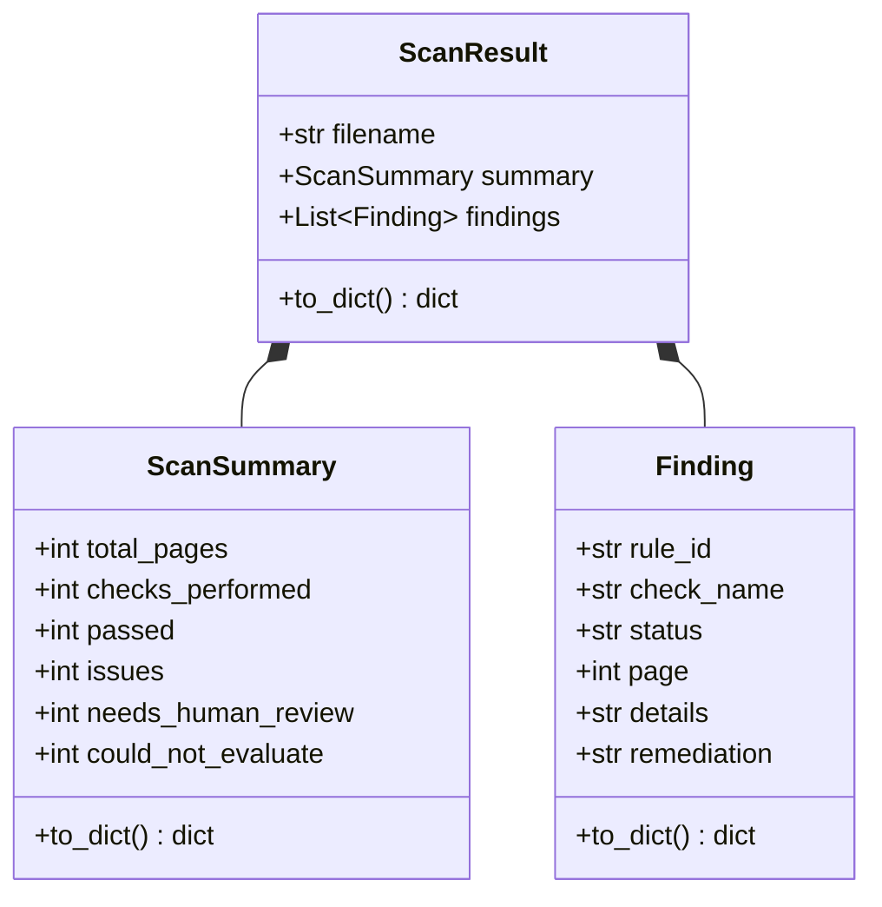
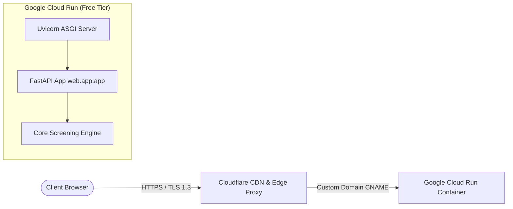

# System Architecture & Technical Specification

> **Executive Summary**: The ADA PDF Accessibility Checker is a decoupled, stream-oriented screening engine designed to evaluate digital PDF documents against key WCAG 2.1 Level AA and ADA Title II technical criteria. It provides both a CLI and an asynchronous FastAPI web service, operating under strict zero-disk-retention privacy guarantees and deploying to Google Cloud Run fronted by Cloudflare.

---

## 1. System Overview & Component Structure

The repository is organized into distinct, decoupled subsystems separating screening logic, delivery interfaces, automated testing, and infrastructure:

```text
ada-pdf-accessibility-checker/
├── core/                       # Core Screening Domain (Engine & Rules)
│   ├── models.py               # Strongly typed dataclasses & JSON serialization
│   ├── checks.py               # Pure, rule-based screening evaluators
│   └── checker.py              # Screening coordinator (dual-engine coordinator)
├── web/                        # Web Application & Delivery Layer
│   ├── app.py                  # FastAPI server & REST API routes
│   ├── storage.py              # In-memory scan job tracker with TTL expiration
│   ├── templates/              # Jinja2 HTML templates
│   │   └── index.html          # Web UI interface
│   └── static/                 # Static delivery assets
│       ├── style.css           # UI styling & accessibility themes
│       └── app.js              # Client-side upload, polling, & render logic
├── tests/                      # Automated Testing Subsystem
│   ├── runner.py               # Acceptance test runner (AC-01 through AC-18)
│   └── fixtures/               # Curated PDF fixtures for deterministic testing
│       ├── fixture_accessible.pdf
│       ├── fixture_scanned.pdf
│       └── fixture_images.pdf
├── docs/                       # Project Documentation & Architecture
│   ├── ARCHITECTURE.md         # This document
│   ├── WCAG_CHECKS_REFERENCE.md# Check definitions, limits, and remediation catalog
│   ├── DECISION_LOG.md         # Architecture Decision Records (ADRs)
│   ├── ROADMAP.md              # Milestone tracking and future enhancements
│   └── CLOUD_HOSTING_COMPARISON.md # Multi-vendor cloud hosting evaluation
├── pdf_checker.py              # Command-line interface (CLI) entry point
├── Dockerfile                  # Container definition for Cloud Run deployment
├── pyproject.toml / uv.lock    # Project dependencies and lockfile (uv)
└── AGENTS.md                   # AI agent instructions and repository invariants
```

### Component Boundaries
- **`core/`**: Completely decoupled from HTTP frameworks and filesystem assumptions. All checks accept opened document handles (`pymupdf.Document` and `pypdf.PdfReader`) and return pure immutable dataclasses.
- **`web/`**: Manages HTTP request lifecycle, background async thread execution, in-memory job status tracking, and HTML/JSON responses.
- **`tests/`**: Independent test suite validating core checks against known fixtures without requiring a live web server.
- **`pdf_checker.py`**: Standalone CLI utility allowing direct terminal use and local batch screening.

---

## 2. Domain Models & Data Contracts

All screening findings and scan payloads adhere to strongly-typed dataclasses defined in [`core/models.py`](file:///home/deltadizzy/Desktop/Programming/Python/ada-pdf-accessibility-checker/core/models.py):



### Status Enums
Every screening evaluation yields exactly one of four normalized statuses:
- **`Pass`**: The structural heuristic was satisfied (e.g. document title metadata exists and is non-empty).
- **`Issue`**: A concrete accessibility barrier was detected (e.g. page lacks extractable digital text).
- **`Needs Human Review`**: Heuristic check succeeded partially or detected elements requiring human judgment (e.g. raster images discovered; alt-text appropriateness requires review).
- **`Could Not Evaluate`**: File corruption, encryption, or parser exception prevented evaluation.

---

## 3. REST API Specifications

The web tier ([`web/app.py`](file:///home/deltadizzy/Desktop/Programming/Python/ada-pdf-accessibility-checker/web/app.py)) exposes an asynchronous REST API:

| Method | Endpoint | Description | Request Payload | Response Status & Body |
|---|---|---|---|---|
| `POST` | `/api/scans/pdf` | Upload and initiate async screening | `multipart/form-data` (`file: UploadFile`) | `202 Accepted` → `{"scan_id": "...", "status": "running"}` |
| `GET` | `/api/scans/{scan_id}/status` | Poll job execution state | None | `200 OK` → `{"scan_id": "...", "status": "running\|completed\|error"}` |
| `GET` | `/api/scans/{scan_id}/results`| Fetch complete screening report | None | `200 OK` → `ScanResult` JSON payload |
| `GET` / `POST` | `/api/test-runner` | Run automated acceptance test suite | None | `200 OK` → `TestSuiteSummary` JSON payload |
| `GET` | `/docs` | Interactive Swagger / OpenAPI documentation | None | `200 OK` (Interactive UI) |

---

## 4. Baseline Security & Privacy Invariants

The screening engine adheres to strict data minimization principles by design:

1. **Zero-Disk Retention (REQ-16, REQ-17)**:
   - User-uploaded PDF files are read directly from network streams into memory buffers (`io.BytesIO`).
   - Uploaded PDF bytes are never written to the filesystem, temporary directories (`/tmp`), or external persistent storage.
   - Once screening finishes, the memory stream is garbage collected.
2. **Ephemeral In-Memory Job Storage**:
   - Scan results and status metadata are stored in thread-safe memory dictionaries ([`web/storage.py`](file:///home/deltadizzy/Desktop/Programming/Python/ada-pdf-accessibility-checker/web/storage.py)).
   - Completed scan results are automatically pruned after a **1-hour TTL** (3600 seconds) to prevent memory accumulation.
3. **No External Exfiltration**:
   - Document contents are evaluated locally using deterministic Python libraries. No external cloud vision, third-party LLMs, or remote analytics receive user document contents.

---

## 5. Production Infrastructure & Ingress Topology



### Google Cloud Run Service Spec:
- **Image**: Multi-stage Linux container based on `python:3.13-slim` managed via `Dockerfile`.
- **Runtime Resources**: `512 MiB` RAM, `1 vCPU`.
- **Concurrency**: Scale-to-zero enabled (`min-instances = 0`, `max-instances = 3`).
- **Entrypoint**: `uvicorn web.app:app --host 0.0.0.0 --port ${PORT:-8080}` with `exec` signal forwarding for instant `SIGINT`/`SIGTERM` container termination.

### Cloudflare Edge Configuration:
- **SSL/TLS**: Universal SSL with **Full (Strict)** encryption to Cloud Run's Google-managed origin certificate.
- **Edge Caching**: Edge Cache Rule configured for `/static/*` with 1-month browser TTL and 1-day edge TTL to maximize performance and minimize Cloud Run container invocations.
- **Egress**: Zero-cost egress routing via Cloudflare's bandwidth alliance.
