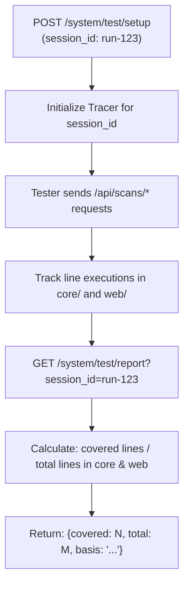

# Code Coverage Implementation Options for System Test Role

> **Executive Summary**: This document evaluates technical options for implementing real-time code coverage tracking on the System role (`GET /system/test/report`) as specified in [`student-facing-spec.md`](student-facing-spec.md). These options are documented for future enhancement; the current production baseline returns `{covered: null, total: null, basis: "Source lines; target instrumentation unavailable"}` in full compliance with specification fallbacks.

---

## 1. Specification Requirements & Rubric Impact

Per [`student-facing-spec.md`](student-facing-spec.md):
- **Baseline Rule**: Returning `null` with an explanatory basis is explicitly compliant:
  ```json
  {
    "session_id": "run-123",
    "coverage": {
      "code": {
        "covered": null,
        "total": null,
        "basis": "Source lines; target instrumentation unavailable"
      }
    }
  }
  ```
- **Specification Intent**: *"The system should measure this; the tester retrieves these measurements through system /test/report and includes them in its report."*
- **Rubric Value**: Measuring executed source statements during test runs provides concrete verification that peer tester API calls actually exercise target application logic.

---

## 2. Evaluation of Implementation Options



### Option A: `coverage.py` API (Recommended for Future Implementation)
Utilize the mature Python `coverage` package programmatically inside FastAPI.

- **Dependencies**: `coverage>=7.6.0` (`uv add coverage`).
- **Lifecycle Integration**:
  - `POST /system/test/setup`: Instantiate and start an isolated `coverage.Coverage` instance bound to the session:
    ```python
    import coverage

    cov = coverage.Coverage(
        source=["core", "web"],
        include=["core/*", "web/app.py", "web/storage.py"],
        omit=["web/cross_team_*", "tests/*"],
    )
    cov.start()
    session.coverage_tracer = cov
    ```
  - During HTTP screening requests: Background tasks and thread pools are automatically instrumented.
  - `GET /system/test/report`: Stop the tracer and compute statement totals:
    ```python
    cov.stop()
    data = cov.get_data()
    total_statements = 0
    covered_statements = 0
    for filename in data.measured_files():
        analysis = cov._analyze(filename)
        total_statements += len(analysis.statements)
        covered_statements += len(analysis.executed)
    ```
- **Pros**:
  - Handles multithreading and async background tasks cleanly.
  - Excludes comments, docstrings, and blank lines automatically (measures real executable statements).
  - High accuracy and well-tested branch coverage capabilities.
- **Cons**: Adds a ~1.5x–2.0x execution slowdown during active test sessions.

---

### Option B: Built-in Standard Library `trace`
Utilize Python's standard `trace` module (`import trace`).

- **Dependencies**: None (included in Python standard library).
- **Lifecycle Integration**:
  - `POST /system/test/setup`: Start tracing using `trace.Trace(count=1, trace=0)`.
  - `GET /system/test/report`: Extract execution counts dictionary and cross-reference with AST line counts for `core/` and `web/`.
- **Pros**: Zero third-party dependencies.
- **Cons**:
  - Does not manage background thread contexts as cleanly as `coverage.py`.
  - Requires manual line parsing to separate executable statements from comments and imports.

---

### Option C: Python 3.12+ `sys.monitoring` (PEP 669)
Utilize the modern low-impact execution monitoring API introduced in Python 3.12.

- **Dependencies**: None (native CPython API).
- **Lifecycle Integration**:
  - Register a `LINE` event callback with `sys.monitoring.register_callback(TOOL_ID, sys.monitoring.events.LINE, callback)`.
  - Store executed `(code_object, line_number)` tuples in a session-specific `set`.
- **Pros**: Near-zero runtime overhead (~2–5% CPU impact compared to ~25–50% for tracing).
- **Cons**: Requires custom bytecode and code-object introspection to map code objects back to source file statement totals.

---

## 3. Architectural Invariants for Future Implementation

When activated in a future sprint, any coverage implementation must respect these safeguards:

1. **Strict Path Scoping**:
   Only measure statements within our application code:
   - Included: `core/checks.py`, `core/checker.py`, `core/models.py`, `web/app.py`, `web/storage.py`.
   - Excluded: C-extensions (`pymupdf`), external packages (`pypdf`, `fastapi`, `uvicorn`), and test harnesses (`tests/*`, `web/cross_team_*`).
2. **Session Isolation**:
   Tracer metrics must be reset per session on `POST /system/test/setup` and must not aggregate server-wide lifetime executions across multiple runs.
3. **Zero Production Overhead**:
   Tracer hooks must remain dormant unless an active test session is initiated via `POST /system/test/setup`. Ordinary public users uploading documents via the `/` web interface must never incur tracer overhead.
