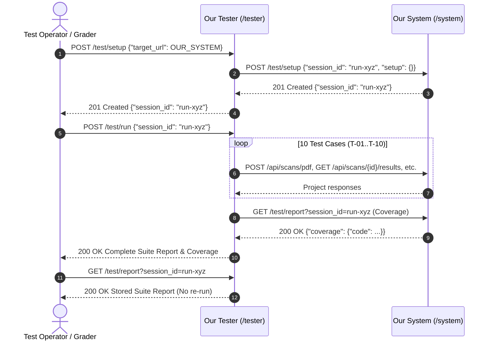
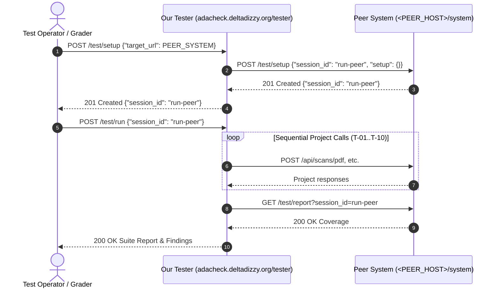

# Cross-Team Testing API Execution Plan

> **Executive Summary**: This document specifies step-by-step procedures for running automated acceptance tests across independent services using the shared testing ConOps defined in [`student-facing-spec.md`](student-facing-spec.md). It details self-testing (our Tester executing against our deployed System) and cross-testing (our Tester executing against the peer team's deployed System, and vice-versa) via standard HTTP API requests.

---

## 1. Service Role Endpoints & URL Topology

Per the testing specification, each team provides two distinct service roles with reachable HTTP(S) base URLs (distinguishable by subpath, without trailing `/test` suffixes):

| Service Role | Base URL (Our Deployment) | Base URL (Peer Team Placeholder) |
|---|---|---|
| **System Role** | `https://adacheck.deltadizzy.org/system` | `https://<PEER_HOST>/system` |
| **Tester Role** | `https://adacheck.deltadizzy.org/tester` | `https://<PEER_HOST>/tester` |

### Environment Variables
For scriptable execution, define these variables in your shell:

```bash
export OUR_SYSTEM="https://adacheck.deltadizzy.org/system"
export OUR_TESTER="https://adacheck.deltadizzy.org/tester"
export PEER_SYSTEM="https://<PEER_HOST>/system"
export PEER_TESTER="https://<PEER_HOST>/tester"
```

---

## 2. Pre-Deployment: Cloud Run Deployment

Before executing tests over public networks, verify that the latest application container (including cross-team routers, session storage, and fixtures) is deployed:

```bash
# 1. Trigger automated deployment script to Google Cloud Run
./deploy.sh

# 2. Verify health and OpenAPI docs on the deployed edge
curl -s -o /dev/null -w "%{http_code}\n" "https://adacheck.deltadizzy.org/docs"
# Expected status: 200
```

---

## 3. Self-Testing Workflow: Our Tester $\rightarrow$ Our System

Self-testing confirms that our deployed Tester service can properly initialize, execute against, and collect coverage from our own deployed System service over HTTPS.



### Step 3.1: Initialize Session (`POST /tester/test/setup`)
Send our System base URL as `target_url` to our Tester setup endpoint:

```bash
SETUP_RESP=$(curl -s -w "\nHTTP_STATUS:%{http_code}" -X POST "${OUR_TESTER}/test/setup" \
  -H "Content-Type: application/json" \
  -d "{\"target_url\": \"${OUR_SYSTEM}\"}")

SESSION_ID=$(echo "${SETUP_RESP}" | sed -e '$d' | jq -r '.session_id')
STATUS=$(echo "${SETUP_RESP}" | tail -n1 | cut -d: -f2)

echo "Setup Status: ${STATUS} | Session ID: ${SESSION_ID}"
```
- **Expected Status**: `201 Created`
- **Expected Body**: `{"session_id": "run-<uuid>"}`
- **Mechanics**: Tester generates a unique UUID, forwards it to `POST ${OUR_SYSTEM}/test/setup`, and returns `201` after System resource preparation succeeds.

### Step 3.2: Run Test Suite (`POST /tester/test/run`)
Execute the 10-test automated suite against the prepared session:

```bash
curl -s -X POST "${OUR_TESTER}/test/run" \
  -H "Content-Type: application/json" \
  -d "{\"session_id\": \"${SESSION_ID}\"}" | jq .
```
- **Expected Status**: `200 OK`
- **Expected Body Structure**:
  ```json
  {
    "session_id": "run-...",
    "target_url": "https://adacheck.deltadizzy.org/system",
    "results": [
      {"test_id": "T-01", "outcome": "pass", "message": "Accessible PDF completed screening with 5 checks."},
      {"test_id": "T-02", "outcome": "pass", "message": "Scanned PDF correctly flagged text extraction issue or review finding."},
      {"test_id": "T-03", "outcome": "pass", "message": "Image resources detected and flagged for review."},
      {"test_id": "T-04", "outcome": "pass", "message": "Expected 404 Not Found for nonexistent scan ID status."},
      {"test_id": "T-05", "outcome": "pass", "message": "Expected 404 Not Found for nonexistent scan ID results."},
      {"test_id": "T-06", "outcome": "pass", "message": "Corrupt input rejected with HTTP 415."},
      {"test_id": "T-07", "outcome": "pass", "message": "Empty request body rejected with HTTP 422."},
      {"test_id": "T-08", "outcome": "pass", "message": "All 5 findings contain all required pod schema fields."},
      {"test_id": "T-09", "outcome": "pass", "message": "All 4 non-passing findings contain actionable remediation guidance."},
      {"test_id": "T-10", "outcome": "pass", "message": "Web scan endpoint returned HTTP 422 (valid descoped prototype response)."}
    ],
    "coverage": {
      "code": {
        "covered": null,
        "total": null,
        "basis": "Source lines; target instrumentation unavailable"
      },
      "component": {
        "covered": 4,
        "total": 4,
        "basis": "4 core screening components evaluated: Document Metadata Inspector, Catalog Structure Inspector, Page Text Layer Extractor, Page Image Resource Inspector"
      },
      "system": {
        "covered": 10,
        "total": 10,
        "basis": "10 pod acceptance criteria evaluated: AC-01 (Multi-page Ingestion), AC-02 (In-Memory Processing), AC-03 (WCAG 2.1 Screening), AC-04 (Repeatability), AC-07 (Finding Traceability), AC-08 (Remediation Completeness), AC-09 (Summary Consistency), AC-10 (REST API Contract), AC-11 (Malformed Input Robustness), AC-12 (Web Scope Conformity)"
      }
    }
  }
  ```

### Step 3.3: Verify Report Persistence (`GET /tester/test/report`)
Verify that the report is persisted and queryable without triggering another test run:

```bash
curl -s -X GET "${OUR_TESTER}/test/report?session_id=${SESSION_ID}" | jq .
```
- **Expected Status**: `200 OK`
- **Duplicate Run Protection**: Re-invoking `POST ${OUR_TESTER}/test/run` with the same `SESSION_ID` returns `409 Conflict`.

---

## 4. Cross-Testing Workflow: Our Tester $\rightarrow$ Peer System

Once the peer team deploys their service, our Tester evaluates their implementation.



### Step 4.1: Initialize Session on Peer System
```bash
PEER_SESSION_RESP=$(curl -s -w "\nHTTP_STATUS:%{http_code}" -X POST "${OUR_TESTER}/test/setup" \
  -H "Content-Type: application/json" \
  -d "{\"target_url\": \"${PEER_SYSTEM}\"}")

PEER_SESSION_ID=$(echo "${PEER_SESSION_RESP}" | sed -e '$d' | jq -r '.session_id')
STATUS=$(echo "${PEER_SESSION_RESP}" | tail -n1 | cut -d: -f2)

echo "Peer Session Status: ${STATUS} | Session ID: ${PEER_SESSION_ID}"
```

#### Diagnostic & Error Scenarios:
- **`201 Created`**: Peer system successfully prepared test session. Proceed to Step 4.2.
- **`404 Not Found`** (`source: system`): Peer team has not implemented `POST /test/setup` on their system router.
- **`500 Internal Server Error`** (`source: communication`): Peer host is offline, URL is mistyped, or SSL/DNS resolution failed.

### Step 4.2: Execute Test Suite Against Peer System
```bash
curl -s -X POST "${OUR_TESTER}/test/run" \
  -H "Content-Type: application/json" \
  -d "{\"session_id\": \"${PEER_SESSION_ID}\"}" | jq .
```
- **Execution Constraints**:
  - Our Tester executes test cases **strictly sequentially** with status polling. This avoids triggering the peer scanner's concurrency guard (`500 CAPACITY_EXCEEDED`).
- **Anticipated Test Case Behaviors**:
  - `T-04`, `T-05`: `pass` (nonexistent IDs return `404 Not Found`).
  - `T-06`: `pass` (peer system validates `%PDF-` header and returns `415` or `400`).
  - `T-07`: `pass` (missing body returns `400` or `422`).
  - `T-10`: `pass` (returns `202` if web scan is implemented, or `422` if descoped).
  - `T-01`, `T-02`, `T-03`: May return `fail` if the peer PDF interpreter remains in stubbed `REJECTED` state. **Note**: Per course grading rubric, tests do not need to pass for full credit on the Phase 3 cross-team check; contract conformity and honest failure reporting are the primary evaluation criteria.

### Step 4.3: Fetch Stored Report for Peer System
```bash
curl -s -X GET "${OUR_TESTER}/test/report?session_id=${PEER_SESSION_ID}" | jq .
```

---

## 5. Peer Cross-Testing Workflow: Peer Tester $\rightarrow$ Our System

When the peer team or course grader executes tests against our deployed System service:

1. **Setup Invocation**:
   ```bash
   curl -X POST "${PEER_TESTER}/test/setup" \
     -H "Content-Type: application/json" \
     -d "{\"target_url\": \"${OUR_SYSTEM}\"}"
   ```
   - Our system receives `POST /system/test/setup` with `{"session_id": "...", "setup": {}}`.
   - Stores session in memory (`web/cross_team_storage.py`) and returns `201 Created`.
2. **Suite Execution**:
   ```bash
   curl -X POST "${PEER_TESTER}/test/run" \
     -H "Content-Type: application/json" \
     -d "{\"session_id\": \"<SESSION_ID>\"}"
   ```
   - Peer tester dispatches requests to `https://adacheck.deltadizzy.org/system/api/scans/pdf`.
   - Polls `GET https://adacheck.deltadizzy.org/system/api/scans/{id}/status`.
   - Retrieves results from `GET https://adacheck.deltadizzy.org/system/api/scans/{id}/results`.
   - Fetches code coverage from `GET https://adacheck.deltadizzy.org/system/test/report?session_id=<SESSION_ID>`.
3. **Report Retrieval**:
   ```bash
   curl -X GET "${PEER_TESTER}/test/report?session_id=<SESSION_ID>"
   ```

---

## 6. Specification Error Compliance Matrix

All error responses from `/test/*` endpoints conform to the spec-mandated schema `{"message": str, "source": str}`:

| Error Condition | Endpoint | Status Code | Required Source Value |
|---|---|---|---|
| Malformed target URL | `POST /tester/test/setup` | `400 Bad Request` | `tester` |
| Unknown session ID | `GET /tester/test/report`, `GET /system/test/report` | `404 Not Found` | `tester` / `system` |
| Duplicate session registration | `POST /system/test/setup` | `409 Conflict` | `system` |
| Duplicate / concurrent suite run | `POST /tester/test/run` | `409 Conflict` | `tester` |
| Report requested before run finishes | `GET /tester/test/report` | `409 Conflict` | `tester` |
| Target network unreachable or timeout | `POST /tester/test/setup`, `POST /tester/test/run` | `500 Internal Server Error` | `communication` |
| Target internal failure (500) | `POST /tester/test/setup`, `POST /tester/test/run` | `500 Internal Server Error` | `system` |
| Unhandled tester logic crash | `POST /tester/test/setup`, `POST /tester/test/run` | `500 Internal Server Error` | `tester` |

---

## 7. Component & System Coverage Rationale

### 7.1 Component Coverage Breakdown & Selection Rationale

The pod contract establishes four decoupled screening components within the document inspection pipeline:

| Component Identifier | Component Name | Internal Target / Mechanics | Exercising Tests |
|---|---|---|---|
| **COMP-1** | **Document Metadata Inspector** | Evaluates document-level metadata dictionaries (`/Title`, `/Lang`) for WCAG 2.4.2 (Page Titled) and WCAG 3.1.1 (Language of Page). | `T-01` |
| **COMP-2** | **Catalog Structure Inspector** | Evaluates document catalog for structural root dictionaries (`/StructTreeRoot`) for WCAG 1.3.1 (Info and Relationships). | `T-01` |
| **COMP-3** | **Page Text Layer Extractor** | Extracts extractable digital character streams from content streams across all pages for WCAG 1.4.5 (Images of Text). | `T-01`, `T-02`, `T-08`, `T-09` |
| **COMP-4** | **Page Image Resource Inspector** | Enumerates page resource dictionaries (`/XObject` subtype `/Image`) to detect raster graphics for WCAG 1.1.1 (Non-text Content). | `T-01`, `T-03`, `T-08`, `T-09` |

#### Rationale for Choosing These 4 Components:
1. **Architectural Completeness**: These four components represent the full pipeline required by the shared Phase 2/3 pod screening specification. Each operates on a distinct syntactic layer of the PDF standard (Document Info Dictionary, Document Catalog Root, Page Content Text Streams, and Page Resource XObjects).
2. **Implementation Decoupling**: A peer system may fail or stub one component (e.g., image extraction or structure parsing) while successfully executing the others. Tracking all four individually ensures that partial implementations are accurately measured rather than treated as a monolithic failure.
3. **Black-Box Observable Verification**: Each component produces distinct findings in the resulting `ScanReport` JSON payload that are verifiable via HTTP assertions without requiring white-box internal access.

---

### 7.2 System Acceptance Criteria Breakdown & Selection Rationale

The cross-team HTTP test harness exercises ten core Acceptance Criteria from our taxonomy:

| Criterion ID | Criterion Title | Description & Target Behavior | Test Mapping |
|---|---|---|---|
| **AC-01** | **Multi-page Ingestion** | Ingestion and processing of multi-page PDF documents across all page streams. | `T-01`, `T-02`, `T-03` |
| **AC-02** | **In-Memory Buffer Processing** | Ingestion of streaming byte buffers via multipart upload without disk retention. | `T-01`, `T-02`, `T-03`, `T-06` |
| **AC-03** | **WCAG 2.1 Screening Rules** | Evaluation of baseline WCAG criteria (Title, Language, Structure, Text, Images). | `T-01`, `T-02`, `T-03` |
| **AC-04** | **Deterministic Repeatability** | Stable, idempotent scan findings across identical inputs. | `T-01` |
| **AC-07** | **Finding Schema Traceability** | Inclusion of all mandated contract fields (`finding_id`, `input_location`, etc.). | `T-08` |
| **AC-08** | **Remediation Completeness** | Inclusion of non-empty remediation guidance on non-passing findings. | `T-09` |
| **AC-09** | **Summary Calculation Integrity** | Correct arithmetic consistency across summary counters (`checks`, `passed`, etc.). | `T-01` |
| **AC-10** | **REST API Contract Conformity** | Standard status codes (`202 Accepted`, `200 OK`, `404 Not Found`). | `T-01`, `T-04`, `T-05` |
| **AC-11** | **Malformed Input Robustness** | Graceful rejection or error reporting on corrupted/invalid payloads. | `T-06`, `T-07` |
| **AC-12** | **Web Scope Conformity** | Predictable contract response (`202` or `422`) for web scanning endpoints. | `T-10` |

#### Rationale for Choosing These 10 Criteria:
1. **Network-Verifiable Black-Box Scope**: These 10 criteria can be verified purely over HTTP by inspecting responses, status codes, and JSON schemas. Criteria excluded from cross-testing (e.g., AC-15 off-by-one page index unit mapping, AC-16 memory garbage collection heap audit, AC-17 zero-disk `/tmp` filesystem watchdog) require local process introspection or filesystem access and are instead verified by the internal test runner (`tests/test_roadmap_sections.py`).
2. **Cross-Team Interoperability Focus**: In a two-team pod where internal frameworks may differ (e.g., PyMuPDF vs. pdfminer vs. pypdf), the cross-team test suite must evaluate shared behavioral boundaries and contract integrity rather than implementation-specific mechanics.
3. **Rubric Alignment**: The selection mirrors the Phase 3 assignment requirements, specifically verifying that both teams adhere to the shared OpenAPI contract, report valid findings schemas, supply actionable remediation, and gracefully intercept invalid inputs.

