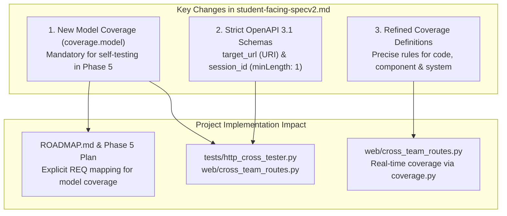

# Specification Revision Diff & Gap Analysis (v1 vs. v2)

> **Document Context**: This document provides a detailed comparative analysis between [`docs/student-facing-spec.md`](student-facing-spec.md) (v1) and [`docs/student-facing-specv2.md`](student-facing-specv2.md) (v2). It analyzes the normative requirements introduced in v2, identifies architectural and implementation gaps, and outlines necessary updates to [`docs/ROADMAP.md`](ROADMAP.md) and the Phase 5 implementation plan ([`phase_5_milestones_6_8_plan.md`](../phase_5_milestones_6_8_plan.md)).

---

## 1. Summary of Changes Between v1 and v2



---

## 2. Detailed Line-by-Line & Semantic Diff

### 2.1 Introduction of `coverage.model` (Model Coverage) — Phase 5 Mandatory
- **Spec v1 (`student-facing-spec.md`)**:
  Only mentioned three coverage measures: `code`, `component`, and `system`.
- **Spec v2 (`student-facing-specv2.md` lines 168, 176–177)**:
  > **"Starting in Phase 5, include `coverage.model` in the tester’s suite report when the tester and target system belong to the same team. Omit it from cross-team reports."**
  >
  > *“Model coverage (`model`): Include this field only when testing your own system. Set total to the number of design requirements your team lists for this milestone. Set covered to the number of those requirements your suite evaluated. These checks help catch drift between your design and implementation as coding agents make changes. In `basis`, identify the design version and link to the mapping between design requirements and tests.”*

#### Semantic Requirements for `coverage.model`:
1. **Conditional Inclusion**:
   - When our tester evaluates our system (`target_url` matches `adacheck.deltadizzy.org` or localhost): **MUST include `coverage.model`**.
   - When our tester evaluates a peer team (`target_url` is external, e.g. `api.potentiate.club`): **MUST omit `coverage.model`**.
2. **Field Structure**:
   ```json
   {
     "covered": 18,
     "total": 18,
     "basis": "Phase 5 Design Model v2.0; mapped against REQ-01 through REQ-18 in docs/WCAG_TAXONOMY.md and docs/ROADMAP.md"
   }
   ```
3. **MAGE Alignment**:
   This requirement directly operationalizes the **Modeling Principle** of Model-Based Agentic Software Engineering. It detects semantic drift between the design model and the agent-generated implementation.

---

### 2.2 Refined Definitions for `code`, `component`, and `system`

| Coverage Field | Spec v1 Baseline | Spec v2 Refinement | Impact on Project |
|---|---|---|---|
| **`code`** | "Source lines or branches executed. The system should measure this; the tester retrieves these measurements through system /test/report..." | *"Count the source lines or branches executed during this test session out of the total in the measured code. The target system measures code coverage and returns it through its `/test/report` endpoint. The tester copies that measurement into the suite report. In `basis`, state whether you measured lines or branches and identify the code included in the measurement."* | Target system must ideally instrument code execution via `coverage.py` rather than relying indefinitely on the `{covered: null, total: null}` fallback. The basis string must state lines vs branches and name included code directories (`core/`, `web/`). |
| **`component`** | "The tester computes how many pod-defined components its tests covered." | *"The tester computes how many pod-defined components its tests covered. The pod specification defines the component list and what counts as exercising each component."* | Retains 4 core components: Document Metadata Inspector, Catalog Structure Inspector, Page Text Layer Extractor, Page Image Resource Inspector. |
| **`system`** | "The tester computes how many pod-defined acceptance criteria its tests covered." | *"Count how many acceptance criteria from the shared pod specification the suite evaluated out of all criteria in scope. This is the measure of feature coverage. Use the pod’s criterion IDs and stated evaluation rules. Count each criterion once, even if multiple tests evaluate it."* | Evaluates AC-01 through AC-18. Explicitly mandates counting each acceptance criterion once regardless of duplicate tests. |
| **`null` Rule** | "Use nonnegative integer counts with covered no greater than total. For any unavailable measure, use null for both counts and explain why; do not substitute zero." | Reaffirmed with identical semantics. | When measurements cannot be collected, use `null` for both `covered` and `total`, accompanied by an explanatory `basis`. Never emit `0` for unmeasured data. |

---

### 2.3 Strict OpenAPI 3.1 Schemas for Tester Endpoints

In `student-facing-specv2.md` (lines 294–332), the minimal OpenAPI description replaced generic `{type: object}` with explicit JSON Schema constraints:

1. **`POST /test/setup`**:
   ```yaml
   requestBody:
     required: true
     content:
       application/json:
         schema:
           type: object
           required: [target_url]
           properties:
             target_url:
               type: string
               format: uri
   ```
   *Impact*: `TesterSetupRequest` Pydantic model must strictly validate `target_url` as a valid URI.

2. **`POST /test/run`**:
   ```yaml
   requestBody:
     required: true
     content:
       application/json:
         schema:
           type: object
           required: [session_id]
           properties:
             session_id:
               type: string
               minLength: 1
   ```
   *Impact*: `TesterRunRequest` Pydantic model must validate `session_id` with `min_length=1`.

---

## 3. Implementation Gaps & Required Updates

### Gap 1: Tester Self-Testing Detection & `coverage.model` Emission
- **Current State**: `tests/http_cross_tester.py` generates a static coverage dictionary with `code`, `component`, and `system`. It never emits `model`.
- **Required Fix**:
  - In `tests/http_cross_tester.py` and `web/cross_team_routes.py`:
    - Inspect `target_url` to determine if the target belongs to our own deployment (`adacheck.deltadizzy.org`, `localhost`, `127.0.0.1`, or local ASGI test server).
    - If **self-testing**: Include `coverage.model` with `total` matching current milestone design requirements (18 requirements: REQ-01 through REQ-18), `covered` matching evaluated requirements, and a persistent `basis` link.
    - If **cross-testing**: Explicitly omit `coverage.model` from the returned JSON dictionary.

### Gap 2: Live Code Coverage Instrumentation via `coverage.py`
- **Current State**: `GET /system/test/report` returns `{covered: null, total: null, basis: "Source lines; target instrumentation unavailable"}`.
- **Required Fix**:
  - Implement Option A from [`docs/CODE_COVERAGE_OPTIONS.md`](CODE_COVERAGE_OPTIONS.md):
  - Add `coverage>=7.6.0` dependency via `uv add coverage`.
  - When `POST /system/test/setup` is called, start a session-scoped `coverage.Coverage(source=["core", "web"], omit=["tests/*", "web/cross_team_*"])` tracer.
  - When `GET /system/test/report` is called, stop the tracer, compute covered and total executable statements, and return exact numbers with `basis: "Source lines executed in core/ and web/ during test session"`.

### Gap 3: Roadmap & Phase 5 Plan Synchronization (Milestones 6–8)
- **Current State**: [`phase_5_milestones_6_8_plan.md`](../phase_5_milestones_6_8_plan.md) details deep structure parsing (M6), contrast analysis (M7), and AI heuristics (M8), but lacks explicit tracing to design model requirements (`coverage.model`) and does not mention the v2 spec requirement.
- **Required Fix**:
  - Update [`docs/ROADMAP.md`](ROADMAP.md) to incorporate Phase 5 v2 compliance:
    - Formalize the 18 design requirements (REQ-01 to REQ-18).
    - Define the exact mapping between design requirements, acceptance criteria, and Milestones 6–8.
  - Update [`phase_5_milestones_6_8_plan.md`](../phase_5_milestones_6_8_plan.md) to include:
    - Step for `coverage.model` conditional emission in self-test reports.
    - Step for real-time `coverage.py` tracking on `GET /system/test/report`.
    - Traceability table mapping Milestone 6–8 features to REQ IDs.

---

## 4. Action Plan for Phase 5 Compliance

1. **Update Phase 5 Implementation Plan** ([`phase_5_milestones_6_8_plan.md`](../phase_5_milestones_6_8_plan.md)):
   - Add Section on **v2 Testing Spec Compliance** (`coverage.model` and `coverage.code`).
   - Include REQ-to-Test traceability matrix.
2. **Update Testing Subsystem**:
   - Modify `tests/http_cross_tester.py` to conditionally inject `coverage.model` for self-tests.
   - Instrument `web/cross_team_routes.py` with `coverage.py` for live line measurements.
3. **Execute Milestones 6–8**:
   - Milestone 6: Deep Semantic Structure Traversal (`core/pdf_struct_parser.py`).
   - Milestone 7: Visual & Contrast Analysis (`core/contrast_analyzer.py`).
   - Milestone 8: Contextual AI Heuristic Assessment & Advisory Engine (`core/ai_evaluator.py`).
4. **Verification**:
   - Run acceptance suite: `uv run python -m tests.runner`.
   - Run self-test via `test.fish` and verify `coverage.model` is present and well-formed.
   - Run cross-test via `test.fish -t` and verify `coverage.model` is omitted.
