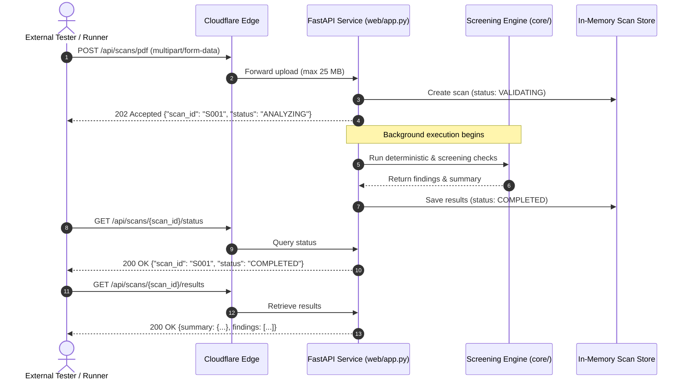
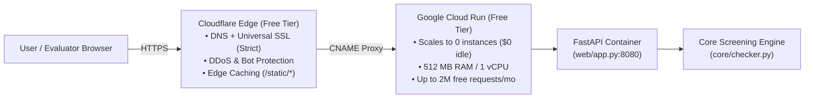
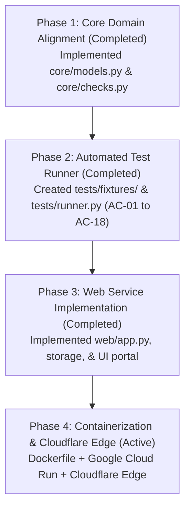

# Web Hosting & Architecture Plan — ADA Accessibility Checker

## 1. Executive Summary & Regulatory Alignment

This plan aligns the ADA PDF Accessibility Checker codebase with the project specification in `api/api.md`, the requirements in `requirements_validation/requirements.md` (REQ-01 through REQ-19), and acceptance criteria in `requirements_validation/acceptance_criteria.md` (AC-01 through AC-18).

The objective is to deploy a lightweight, scalable web service that supports:
1. **Asynchronous REST API:** Implements the official scan lifecycle (`POST /api/scans/pdf`, `POST /api/scans/web`, `GET /api/scans/{scan_id}/status`, `GET /api/scans/{scan_id}/results`).
2. **Standardized Finding Model:** Formats findings into `finding_id`, `input_location`, `issue_description`, `WCAG_criterion`, `analysis_method`, `status`, and `remediation_guidance`.
3. **Automated Test Runner System:** An automated test harness validating acceptance criteria against curated fixture PDFs and web endpoints.
4. **Cloudflare & Scale-to-Zero Deployment:** 100% free for <1,000 requests on container compute (Google Cloud Run / Render) fronted by Cloudflare's free edge network.

---

## 2. API Specification & Status Lifecycle (per `api/api.md`)



### 2.1 Formal Endpoints Matrix

| Method | Endpoint | Request | Success Response | Error Codes | Requirements |
|---|---|---|---|---|---|
| `POST` | `/api/scans/pdf` | `multipart/form-data` with `file` (≤25 MB) | `202 Accepted`<br/>`{"scan_id": str, "status": "ANALYZING"}` | `400` (corrupt), `413` (>25MB), `415` (non-PDF), `500` | REQ-02, REQ-03, REQ-12, REQ-15 |
| `POST` | `/api/scans/web` | JSON `{"url": "https://..."}` | `422 Unprocessable Entity`<br/>`{"error": "UNSUPPORTED_INPUT", "message": "Webpage scanning is outside current prototype scope; use /api/scans/pdf."}` *(or 202 transitioning to REJECTED)* | `400` (invalid URL), `422` (unsupported/scope), `500` | REQ-01, REQ-02, REQ-12 |
| `GET` | `/api/scans/{scan_id}/status` | Path parameter `scan_id` | `200 OK`<br/>`{"scan_id": str, "status": "<STATE>"}` | `404` (not found) | REQ-12, REQ-13, REQ-18 |
| `GET` | `/api/scans/{scan_id}/results` | Path parameter `scan_id` | `200 OK`<br/>`{summary: {...}, findings: [...]}` | `404` (not found), `409` (not ready) | REQ-06–REQ-10, REQ-15, REQ-17 |
| `POST` | `/api/test-runner` | Optional JSON options | `200 OK`<br/>`{total: int, passed: int, results: [...]}` | `500` | AC-01–AC-18 automated test suite |
| `GET` | `/` | Web browser | `200 OK` (HTML Portal) | — | Human evaluator testing portal |
| `GET` | `/docs` | Web browser | `200 OK` (OpenAPI Swagger UI) | — | Direct interactive test interface |

### 2.2 Domain Enums and Allowed Values
- **Scan Status:** `VALIDATING` | `ANALYZING` | `GENERATING_REPORT` | `COMPLETED` | `REJECTED`
- **Finding Status:** `Pass` | `Issue` | `Needs Human Review` | `Could Not Evaluate`
- **Analysis Method:** `Deterministic` | `AI` | `Human Review`

---

## 3. Web Hosting & Infrastructure: Google Cloud Run + Cloudflare Edge

### 3.1 Compute vs. Edge Architecture
- **Compute Host:** **Google Cloud Run (Free Tier)**. Fully managed serverless container runtime that scales to 0 instances when idle, completely eliminating idle server costs and VM maintenance.
- **Resource Sizing:**
  - **Memory:** `512 MiB` (optimal for 25 MB PDF stream + PyMuPDF C parsing allocations + ~150 MB safety margin).
  - **CPU:** `1 vCPU`.
  - **Scaling:** `min-instances: 0` (scales to zero when idle = $0 cost), `max-instances: 2`.
  - **Concurrency:** `40` concurrent requests per container.
  - **Monthly Free Tier Quota:** 2,000,000 requests, 360,000 GB-seconds (720,000 active seconds at 512 MB), 180,000 vCPU-seconds, and 1 GB outbound egress to North America.
- **Edge Layer:** **Cloudflare Free Tier**. Manages DNS, SSL/TLS termination, edge caching, and DDoS protection. Crucially, Cloudflare's edge cache shields Cloud Run from exceeding its 1 GB monthly egress quota by caching static assets (`/static/*`) and repeated reports.



---

### 3.2 Docker Containerization Specification

#### 1. Production `Dockerfile`
Standard container build optimized for Google Cloud Run:
```dockerfile
FROM python:3.13-slim

WORKDIR /app

# Prevent Python from writing .pyc files and enable unbuffered output for Cloud Logging
ENV PYTHONDONTWRITEBYTECODE=1 \
    PYTHONUNBUFFERED=1 \
    PORT=8080

# Install build dependencies
RUN apt-get update && apt-get install -y --no-install-recommends \
    ca-certificates \
    && rm -rf /var/lib/apt/lists/*

# Copy dependency definitions and install
COPY pyproject.toml requirements.txt /app/
RUN pip install --no-cache-dir -r requirements.txt

# Copy application source code
COPY core/ /app/core/
COPY web/ /app/web/
COPY pdf_checker.py /app/

EXPOSE 8080

CMD ["uvicorn", "web.app:app", "--host", "0.0.0.0", "--port", "8080"]
```

#### 2. `.dockerignore`
Prevents local virtual environments, test fixtures, and Git files from inflating the container image:
```text
.git/
.venv/
__pycache__/
*.pyc
*.pyo
tests/fixtures/*.pdf
!tests/fixtures/fixture_*.pdf
*.json
.pytest_cache/
```

#### 3. Local Container Verification
```bash
# Build image locally
docker build -t ada-checker .

# Run container locally
docker run --rm -p 8080:8080 -e PORT=8080 ada-checker

# Test endpoint
curl http://localhost:8080/
```

---

### 3.3 Google Cloud Run Deployment Steps

#### Step 1: Install & Authenticate Google Cloud CLI
- Install the Google Cloud SDK: [Google Cloud SDK Installation Guide](https://cloud.google.com/sdk/docs/install)
- Authenticate and configure your project:
  ```bash
  gcloud auth login
  gcloud config set project YOUR_GCP_PROJECT_ID
  ```

#### Step 2: Enable Required GCP APIs
Enable Cloud Run and Artifact Registry (one-time setup):
```bash
gcloud services enable run.googleapis.com artifactregistry.googleapis.com
```

#### Step 3: Deploy Directly from Source
Google Cloud Run builds the container automatically using Cloud Build:
```bash
gcloud run deploy ada-pdf-checker \
  --source . \
  --region us-central1 \
  --allow-unauthenticated \
  --port 8080 \
  --memory 512Mi \
  --cpu 1 \
  --min-instances 0 \
  --max-instances 2 \
  --concurrency 40
```
Upon completion, Cloud Run outputs the default service URL:
`https://ada-pdf-checker-[hash]-uc.a.run.app`

---

### 3.4 Cloudflare DNS & Edge Setup (Step-by-Step with Gotchas Solved)

Connecting a custom domain (e.g., `checker.yourdomain.com`) through Cloudflare to Google Cloud Run involves specific DNS configurations. Follow these precise instructions to avoid common 525/526 SSL errors, redirect loops, and 404 Host header mismatches.

#### Option A: Cloudflare CNAME to Cloud Run Domain Mapping (Standard)

1. **Step 1: Register Custom Domain in Google Cloud Run**
   ```bash
   gcloud beta run domain-mappings create \
     --service ada-pdf-checker \
     --domain checker.yourdomain.com \
     --region us-central1
   ```
   Cloud Run outputs required DNS records, typically:
   - **Type:** `CNAME`
   - **Record:** `ghs.googlehosted.com.`

2. **Step 2: Initial Verification in Cloudflare (CRITICAL DNS-ONLY MODE)**
   > **Warning (Gotcha 1 — Certificate Verification Failure):** When Google requests the initial SSL certificate, Google's Certificate Authority checks domain ownership via HTTP-01 or DNS. If Cloudflare Proxy is enabled immediately, Cloudflare intercepts the challenge and Google's certificate provisioning fails.
   - In Cloudflare Dashboard → **DNS** → **Records**:
     - **Type:** `CNAME`
     - **Name:** `checker` (for `checker.yourdomain.com`)
     - **Target:** `ghs.googlehosted.com`
     - **Proxy status:** **DNS only (Grey Cloud)** ⚠️ *Keep Grey until Google verifies!*
     - **TTL:** `Auto`

3. **Step 3: Wait for Google Certificate Provisioning**
   - Check status: `gcloud beta run domain-mappings describe --domain checker.yourdomain.com --region us-central1`
   - Wait until Google reports `Certificate: True` / `Ready: True` (usually 10–20 minutes).

4. **Step 4: Enable Cloudflare Proxy & Configure SSL (CRITICAL REDIRECT LOOP PREVENTION)**
   > **Warning (Gotcha 2 — The "ERR_TOO_MANY_REDIRECTS" / 525 Error):** Cloud Run enforces HTTPS automatically. If Cloudflare's SSL/TLS mode is set to "Flexible", Cloudflare communicates with Cloud Run over unencrypted HTTP (port 80). Cloud Run replies with a 301 redirect to HTTPS. Cloudflare receives this and repeats the HTTP request, creating an infinite redirect loop.
   - In Cloudflare Dashboard → **SSL/TLS**:
     - Set encryption mode to **Full** or **Full (Strict)**. *(Never use Flexible).*
   - In Cloudflare Dashboard → **DNS** → **Records**:
     - Edit the `checker` CNAME record and switch Proxy status to **Proxied (Orange Cloud)**.

---

#### Option B: Cloudflare Origin Rules Direct Reverse Proxy (Advanced / Zero-Wait)
*If you want to skip Google's Domain Mapping verification and route directly to the Cloud Run `.run.app` address:*

> **Warning (Gotcha 3 — Cloud Run 404 on Direct CNAME):** If you create a CNAME directly pointing `checker.yourdomain.com` to `ada-pdf-checker-[hash]-uc.a.run.app`, Cloud Run returns `HTTP 404: Not Found`. This is because Cloud Run uses the HTTP `Host` header to route requests to container services, and by default Cloudflare passes the original `Host: checker.yourdomain.com`.

**How to configure Cloudflare Origin Rule:**
1. In Cloudflare Dashboard → **DNS** → **Records**:
   - **Type:** `CNAME`
   - **Name:** `checker`
   - **Target:** `ada-pdf-checker-[hash]-uc.a.run.app`
   - **Proxy status:** **Proxied (Orange Cloud)**
2. In Cloudflare Dashboard → **Rules** → **Origin Rules**:
   - Click **Create rule**:
     - Rule name: `Route to Cloud Run Origin`
     - Expression: `(http.host eq "checker.yourdomain.com")`
     - **Host Header:** Select **Rewrite to...** and enter `ada-pdf-checker-[hash]-uc.a.run.app`
     - **Server Name Indication (SNI):** Select **Override to...** and enter `ada-pdf-checker-[hash]-uc.a.run.app`
3. In Cloudflare Dashboard → **SSL/TLS**:
   - Set to **Full (Strict)**.
   - Result: Traffic is routed directly to Cloud Run instantly with zero domain-mapping wait time.

---

#### Edge Caching Configuration (Protecting Free Tier Egress)
Google Cloud Run free tier provides 1 GB of monthly egress. To protect against egress billing when users download large PDFs or test JSON reports:
1. In Cloudflare Dashboard → **Caching** → **Cache Rules**:
   - Click **Create rule**:
     - Rule name: `Cache Static Assets`
     - Expression: `starts_with(http.request.uri.path, "/static/")`
     - Cache eligibility: **Eligible for cache**
     - Edge TTL: **1 month**
     - Browser TTL: **1 day**
2. Results: CSS (`style.css`), JS (`app.js`), and favicon requests are served entirely from Cloudflare Edge without hitting Cloud Run container instances or counting against egress quotas.

### 3.5 Security & Data Protection (REQ-16, REQ-17)
- **In-Memory Buffer Processing:** PDF files are streamed into Python memory buffers (`io.BytesIO`) and evaluated directly; no uploaded files are written to container disk.
- **Short-Lived Scan Store:** Scan results and in-memory references expire after 1 hour or upon request.
- **Secret Isolation:** No API keys or credentials committed or output in accessibility reports.

---

## 4. Modular File Architecture & Component Specifications

```text
ada-pdf-accessibility-checker/
├── core/
│   ├── __init__.py           # Package exports
│   ├── models.py             # Dataclasses adhering to api/api.md schema
│   ├── checks.py             # Pure deterministic WCAG check functions
│   └── checker.py            # PDF & Web scanning coordinator
├── tests/
│   ├── fixtures/             # Curated PDFs for deterministic validation
│   │   ├── fixture_accessible.pdf
│   │   ├── fixture_scanned.pdf
│   │   └── fixture_images.pdf
│   └── runner.py             # Automated test suite (AC-01 through AC-18)
├── web/
│   ├── __init__.py
│   ├── app.py                # FastAPI routes matching api/api.md
│   ├── storage.py            # In-memory scan state & results manager
│   └── templates/
├── docs/                     # Project documentation directory
│   ├── PROJECT_DOCUMENTATION.md
│   ├── FUTURE_WORK.md
│   ├── PROJECT_HANDOFF.md
│   └── WEB_HOSTING_AND_ARCHITECTURE_PLAN.md
├── AGENTS.md                 # AI agent contributor instructions and guidelines
├── README.md                 # Repository overview
├── Dockerfile                # Production container for Cloud Run / Render
├── pdf_checker.py            # Backward-compatible CLI wrapper
└── pyproject.toml            # Project dependencies
```

### 4.1 Component Details

#### 1. `core/models.py`
Defines data structures mapped directly to `api/api.md`:
```python
from dataclasses import dataclass, field
from typing import Literal, Optional

ScanStatus = Literal["VALIDATING", "ANALYZING", "GENERATING_REPORT", "COMPLETED", "REJECTED"]
FindingStatus = Literal["Pass", "Issue", "Needs Human Review", "Could Not Evaluate"]
AnalysisMethod = Literal["Deterministic", "AI", "Human Review"]

@dataclass
class Finding:
    finding_id: str
    input_location: str
    issue_description: str
    WCAG_criterion: str
    analysis_method: AnalysisMethod
    status: FindingStatus
    remediation_guidance: Optional[str] = None
    additional_details: Optional[str] = None

@dataclass
class ScanSummary:
    checks: int = 0
    passed: int = 0
    issues: int = 0
    human_review: int = 0
    could_not_evaluate: int = 0

@dataclass
class ScanResult:
    scan_id: str
    file_or_url: str
    summary: ScanSummary
    findings: list[Finding] = field(default_factory=list)
```

#### 2. `core/checks.py`
Implements deterministic checks with remediation guidance (REQ-05, REQ-08, REQ-09):
- `check_title()`: Cites WCAG 2.4.2 (Level A). Remediation: "Add a descriptive title in document properties."
- `check_language()`: Cites WCAG 3.1.1 (Level A). Remediation: "Set default document language in catalog."
- `check_structure()`: Cites WCAG 1.3.1 (Level A). Remediation: "Add document structure tags using authoring tool."
- `check_text_layer()`: Cites WCAG 1.4.5 (Level AA). Remediation: "Perform Optical Character Recognition (OCR)."
- `check_images()`: Cites WCAG 1.1.1 (Level A). Remediation: "Add alternative text for meaningful graphics."

#### 3. `web/storage.py`
In-memory thread-safe dictionary managing scan jobs:
- Tracks `scan_id -> {"status": ScanStatus, "results": Optional[ScanResult], "error": Optional[dict]}`.
- Auto-prunes scans older than 1 hour (REQ-16).

#### 4. `web/app.py`
FastAPI application mounting the specification endpoints:
- Validates 25 MB file limit, rejecting oversized files with HTTP 413.
- Validates MIME type, rejecting non-PDFs with HTTP 415.
- Dispatches background scan task, returning HTTP 202 immediately.
- Rejects `POST /api/scans/web` with HTTP 422 / `REJECTED` state explaining web scanning is outside current prototype scope (REQ-12).
- Provides interactive Swagger documentation at `/docs`.

#### 5. `tests/runner.py`
Automated test runner verifying acceptance criteria:
- Tests deterministic repetition (AC-04).
- Tests oversized/corrupt negative cases (AC-02, AC-11).
- Tests summary counts match findings exactly (AC-09).
- Tests disclaimer presence (AC-10, REQ-11).
- Returns structured JSON for HTTP `/api/test-runner` or terminal execution.

---

## 5. Phased Implementation Roadmap



### Next Immediate Action:
Proceed with **Phase 4**: create `Dockerfile` and `.dockerignore`, verify local container execution, and prepare Google Cloud Run deployment.
