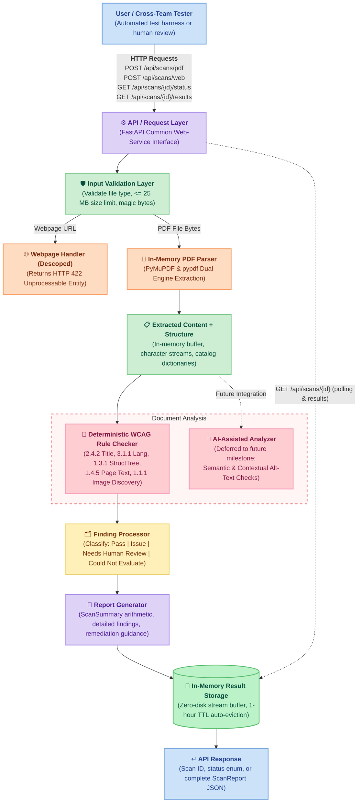
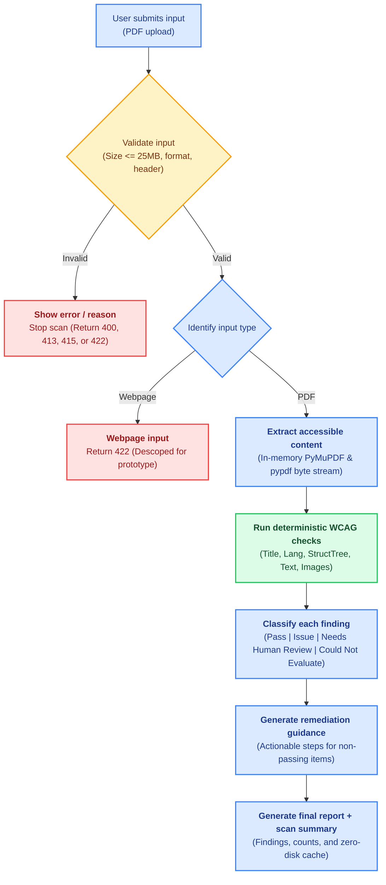
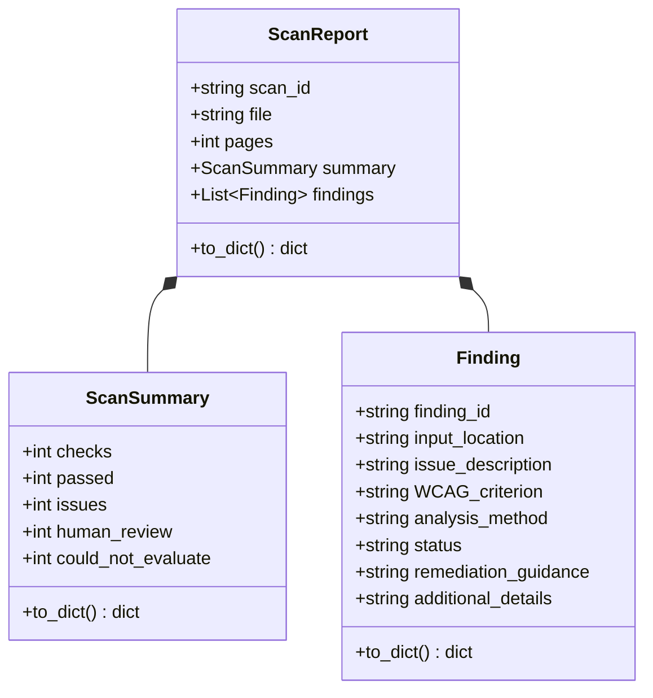
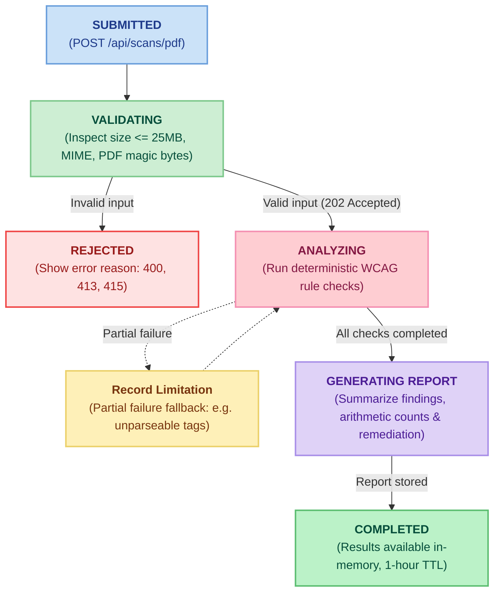

# Architecture & Behavioral Diagrams

This directory contains visual and text-based architectural and behavioral models of the ADA PDF Accessibility Checker application.

> **Note**: Diagrams are defined in the standalone `.mmd` files in this directory as the single source of truth. Running `python3 scripts/sync_diagrams.py` automatically synchronizes any updates to `.mmd` files into this document.

---

## 1. System Architecture and Data Flow

**Source**: [`architecture_diagram.mmd`](architecture_diagram.mmd) (updates [`architecture_diagram.jpg`](architecture_diagram.jpg))

<!-- BEGIN:architecture_diagram -->

<!-- END:architecture_diagram -->

---

## 2. Accessibility Scan Workflow (Model 1)

**Source**: [`scan_workflow.mmd`](scan_workflow.mmd) (updates [`Behavioral_information_model.png`](Behavioral_information_model.png))

<!-- BEGIN:scan_workflow -->

<!-- END:scan_workflow -->

---

## 3. Finding Data Model (Model 2)

**Source**: [`finding_data_model.mmd`](finding_data_model.mmd)

<!-- BEGIN:finding_data_model -->

<!-- END:finding_data_model -->

---

## 4. Scan State Lifecycle Model (Model 3)

**Source**: [`scan_state_model.mmd`](scan_state_model.mmd)

<!-- BEGIN:scan_state_model -->

<!-- END:scan_state_model -->
